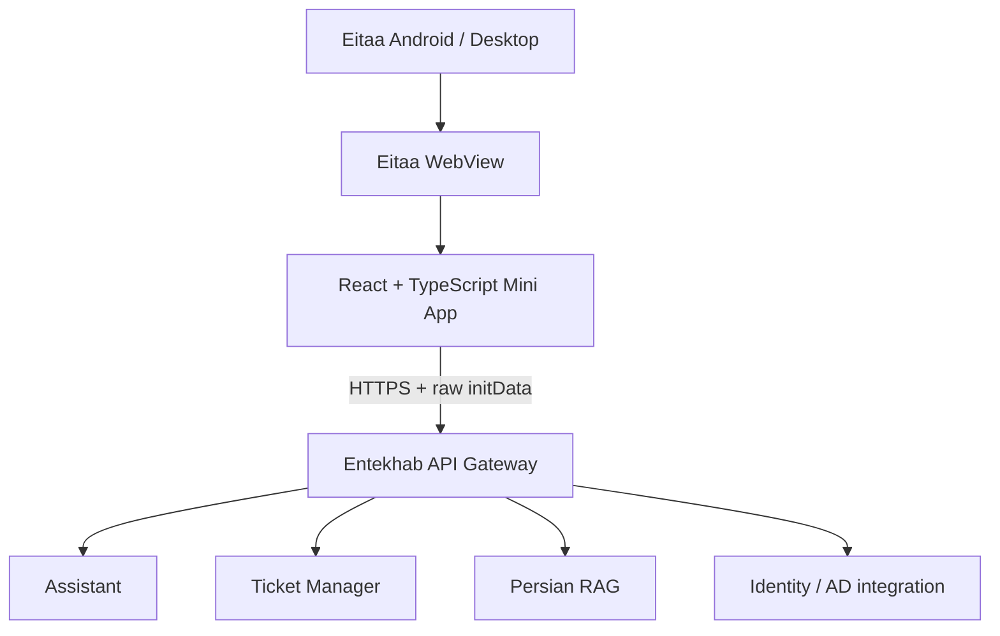

# معماری برنامک همیار انتخاب

## اصول غیرقابل مذاکره

1. این مخزن یک کلاینت مستقل Eitaa Mini App است؛ کد یا چرخه انتشار ChatBot-Web-Client و ITBot-Bale را تغییر نمی‌دهد.
2. Gateway تنها مرز ارتباط با Backend سازمانی است.
3. هیچ اتصال مستقیم از مرورگر به Assistant، PersianRag، ActiveDirctoryManager، TicketManager، پایگاه داده یا سرویس مدل وجود ندارد.
4. هویت ایتا باید در سمت سرور اعتبارسنجی شود؛ داده نمایشی کلاینت هویت معتبر نیست.
5. قراردادهای موجود Gateway باید با شواهد مخزن/محیط تطبیق داده شوند، نه با حدس یا قرارداد فرضی.

## نمای سطح بالا

## لایه‌های Frontend

- **app**: bootstrap، composition و route shell.
- **features**: قابلیت‌های مستقل assistant، tickets، knowledge و profile.
- **components**: اجزای UI مشترک و بدون منطق دامنه.
- **services**: transport و adapterهای ارتباط با Gateway.
- **eitaa**: bridge محدود به SDK رسمی Eitaa.
- **styles**: design tokens، RTL و responsive rules.

## مرز Backend

در Phase 0، Gateway integration فقط یک مرز مستندشده است. مسیر endpoint احراز هویت ایتا، قرارداد تبدیل هویت ایتا به نشست سازمانی و سیاست rate limit باید در Gateway تعیین و پیاده‌سازی شود. کلاینت نباید Service JWT اکوسیستم را تولید یا نگهداری کند.

## قراردادهای شناخته‌شده از اکوسیستم

- مسیر چت شناخته‌شده در اکوسیستم: `POST /api/v1/chat`.
- Gateway در اکوسیستم نقطه ورود واحد است.
- جزئیات payload، روش انتقال توکن، ticket routes، knowledge routes و claims باید از نسخه جاری Gateway استخراج و در این سند ثبت شوند؛ تا آن زمان پیاده‌سازی آن‌ها مسدود است.

## تصمیمات فنی

- React + TypeScript + Vite برای کلاینت.
- Modular frontend با feature boundaries؛ نه micro-frontend.
- SDK رسمی از CDN ایتا بارگذاری می‌شود؛ فایل SDK در مخزن vendoring نمی‌شود.
- Browser preview صرفاً برای توسعه UI است و نباید نقش شبیه‌ساز احراز هویت داشته باشد.
- وابستگی‌ها حداقلی نگه داشته می‌شوند تا bundle و سطح حمله محدود بماند.
