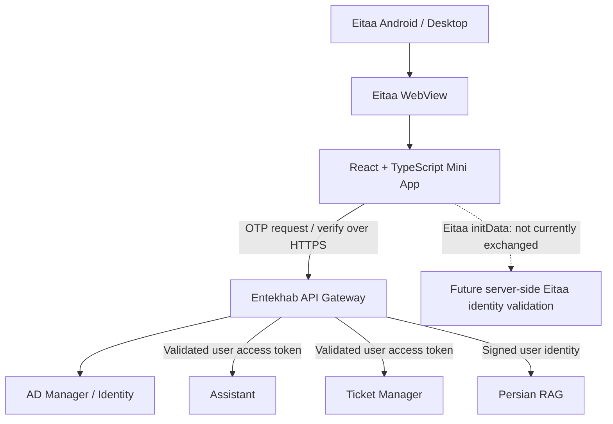

# معماری برنامک همیار انتخاب

## اصول غیرقابل مذاکره

1. این مخزن یک کلاینت مستقل Eitaa Mini App است؛ کد یا چرخه انتشار ChatBot-Web-Client و ITBot-Bale را تغییر نمی‌دهد.
2. Gateway تنها مرز ارتباط با Backend سازمانی است.
3. هیچ اتصال مستقیم از مرورگر به Assistant، PersianRag، ActiveDirctoryManager، TicketManager، پایگاه داده یا سرویس مدل وجود ندارد.
4. احراز هویت سازمانی نسخه اول از OTP موبایل ثبت‌شده در AD و User Access Token صادرشده توسط AD Manager از طریق Gateway انجام می‌شود.
5. داده‌های Eitaa WebApp مانند initData و initDataUnsafe جایگزین احراز هویت سازمانی نیستند. اعتبارسنجی initData در Gateway فعلی endpoint پیاده‌سازی‌شده‌ای ندارد.
6. قراردادهای موجود Gateway باید با شواهد مخزن/محیط تطبیق داده شوند، نه با حدس یا قرارداد فرضی.

## نمای سطح بالا

## لایه‌های Frontend

- **app**: bootstrap، composition و route shell.
- **features**: قابلیت‌های مستقل assistant، tickets، knowledge و profile.
- **components**: اجزای UI مشترک و بدون منطق دامنه.
- **services**: transport و adapterهای ارتباط با Gateway.
- **eitaa**: bridge محدود به SDK رسمی Eitaa.
- **styles**: design tokens، RTL و responsive rules.

## مرز Backend

Gateway در حال حاضر مسیرهای OTP سازمانی، چت، پروفایل، تیکت و proxyهای راهنمای دانش را پیاده‌سازی می‌کند. Mini App باید از قراردادهای ثبت‌شده در `docs/API-CONTRACTS.md` استفاده کند.

برای درخواست‌های محافظت‌شده کاربر، Gateway علاوه بر User Access Token، یک `X-Client-ID` مجاز می‌خواهد. شناسه اختصاصی Eitaa باید در تنظیمات `PUBLIC_USER_CLIENT_IDS` محیط Gateway اضافه شود. این شناسه صرفاً client identifier است و اثبات اصالت WebView نیست.

کلاینت نباید Service JWT اکوسیستم را تولید یا نگهداری کند. سند Gateway درباره Eitaa Service JWT فقط برای ارتباط backend-to-backend است و مجوز قرار دادن Service JWT در کد مرورگر محسوب نمی‌شود.

## قراردادهای شناخته‌شده از اکوسیستم

- احراز هویت: `POST /api/v1/identity/otp/request` و `POST /api/v1/identity/otp/verify`.
- چت: `POST /api/v1/chat`.
- پروفایل: `GET /api/v1/me`.
- تیکت: مسیرهای `/api/v1/tickets`.
- راهنماهای دانش: `GET /api/v1/guides/it` و `GET /api/v1/guides/organization`.
- در Gateway بررسی‌شده، proxy عمومی جستجوی آزاد RAG مشاهده نشده است.
- مسیر `/api/v1/chat/stream` در کد فعلی streaming واقعی ارائه نمی‌کند.

جزئیات Headerها، payload، پاسخ، محدودیت‌ها و موانع استقرار در `docs/API-CONTRACTS.md` ثبت شده‌اند.

## تصمیمات فنی

- React + TypeScript + Vite برای کلاینت.
- Modular frontend با feature boundaries؛ نه micro-frontend.
- SDK رسمی از CDN ایتا بارگذاری می‌شود؛ فایل SDK در مخزن vendoring نمی‌شود.
- Browser preview صرفاً برای توسعه UI است و نباید نقش شبیه‌ساز احراز هویت داشته باشد.
- وابستگی‌ها حداقلی نگه داشته می‌شوند تا bundle و سطح حمله محدود بماند.
- CORS و allowlist کلاینت باید در محیط Gateway برای دامنه HTTPS واقعی و شناسه اختصاصی Eitaa تنظیم شوند؛ این تغییرات در این مخزن یا Gateway اعمال نشده‌اند.
