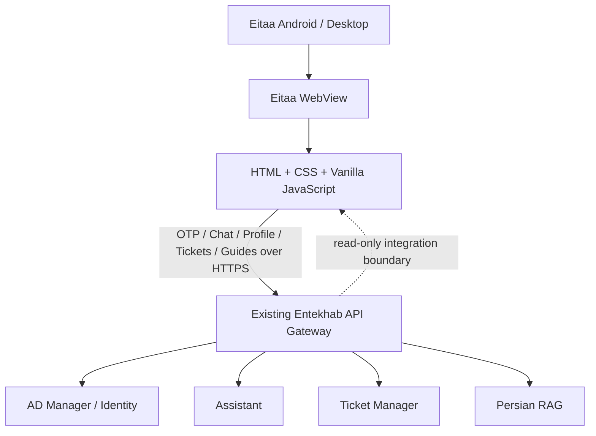

# معماری برنامک همیار انتخاب

## اصول غیرقابل مذاکره

1. این مخزن یک کلاینت مستقل Eitaa Mini App است؛ کد یا چرخه انتشار ChatBot-Web-Client و ITBot-Bale را تغییر نمی‌دهد.
2. Gateway تنها مرز ارتباط با Backend سازمانی است و در این پروژه صرفاً مصرف می‌شود؛ تغییر Gateway خارج از محدوده کار است.
3. هیچ اتصال مستقیمی از مرورگر به Assistant، PersianRag، ActiveDirctoryManager، TicketManager، پایگاه داده یا سرویس مدل وجود ندارد.
4. احراز هویت سازمانی از OTP موبایل یا کد پرسنلی و User Access Token صادرشده از مسیر canonical Gateway انجام می‌شود.
5. برای کلاینت ایتا، Gateway مقدار خام امضاشده `window.Eitaa.WebApp.initData` را در Header دریافت و سمت سرور اعتبارسنجی می‌کند. `initDataUnsafe` صرفاً برای نمایش اطلاعات و UX است و مدرک احراز هویت نیست.
6. قراردادهای موجود Gateway باید با شواهد مخزن تطبیق داده شوند؛ مسیر، Header یا payload فرضی نباید ساخته شود.

## نمای سطح بالا

## ساختار Frontend

- `index.html`: ساختار معنایی صفحه و بارگذاری SDK.
- `src/styles/`: طراحی بصری، RTL و responsive rules.
- `src/app.js`: bootstrap و رفتارهای رابط کاربری.
- `src/config.js`: تنظیمات عمومی مرورگر؛ فقط مقادیر غیرمحرمانه.
- `src/eitaa/`: bridge محدود به SDK رسمی Eitaa.
- `src/services/`: transport و adapterهای ارتباط با Gateway.
- `src/features/`: رابط و state هر قابلیت محصول.

از JavaScript ماژولار بومی مرورگر (ES Modules) استفاده می‌شود. هیچ framework، transpiler، bundler یا مرحله build وجود ندارد. منطق UI از transport و قراردادهای Backend جدا می‌ماند.

## مرز Backend

Gateway تنها مرز Backend است. برای درخواست‌های کاربرمحور، User Access Token صادرشده پس از OTP باید همراه شناسه کلاینت مجاز ارسال شود. `X-Client-ID` فقط شناسه کلاینت است و به‌تنهایی احراز هویت یا اثبات اصالت WebView محسوب نمی‌شود.

کلاینت نباید Service JWT اکوسیستم، Bot Token، private key یا credential سازمانی را تولید یا نگهداری کند. Service JWT فقط برای ارتباط backend-to-backend و در سمت سرور است.

## قراردادهای شناخته‌شده

جزئیات Headerها، payload، پاسخ‌ها، محدودیت‌ها و موانع استقرار در `docs/API-CONTRACTS.md` ثبت شده‌اند. مسیرهای شناخته‌شده:

- احراز هویت: `POST /api/v1/identity/otp/request` و `POST /api/v1/identity/otp/verify`.
- چت: `POST /api/v1/chat`.
- پروفایل: `GET /api/v1/me`.
- تیکت: مسیرهای `/api/v1/tickets`.
- راهنماهای دانش: `GET /api/v1/guides/it` و `GET /api/v1/guides/organization`.
- در Gateway بررسی‌شده، proxy عمومی جستجوی آزاد RAG مشاهده نشده است.
- مسیر `/api/v1/chat/stream` در کد بررسی‌شده streaming واقعی ارائه نمی‌کند؛ UI نباید streaming را فرض کند.

## محدودیت‌های احراز هویت در فاز فعلی

- Gateway در هر دو مرحله Request و Verify، `X-Eitaa-Init-Data` را اعتبارسنجی می‌کند.
- برای ورود کد پرسنلی، شناسه عمومی Challenge یک handle opaque متعلق به Gateway است؛ شناسه داخلی AD Manager به مرورگر داده نمی‌شود.
- Challenge و Rate Limiting ایتا در پیاده‌سازی فعلی process-local هستند؛ طبق کد و مستند Gateway، اجرای چند Worker/Replica یا restart می‌تواند نشست OTP در حال انجام را مختل کند.
- `Idempotency-Key` در این مرحله از نظر وجود و طول اعتبارسنجی می‌شود؛ replay-safe idempotency پیاده‌سازی نشده است.
- این محدودیت‌ها باید در اسناد و تست پذیرش باقی بمانند؛ Mini App نباید آن‌ها را با ذخیره‌سازی محلی یا ادعای امنیتی پنهان کند.

## تصمیمات فنی

- HTML5 + CSS3 + Vanilla JavaScript (ES Modules).
- بدون React، Vue، Angular، TypeScript، JSX، Vite، bundler یا کتابخانه UI.
- SDK رسمی از CDN ایتا بارگذاری می‌شود؛ فایل SDK در مخزن vendoring نمی‌شود.
- Browser preview صرفاً برای توسعه UI است و نباید نقش شبیه‌ساز احراز هویت داشته باشد.
- Gateway فقط مصرف می‌شود. هر تغییر CORS، allowlist، secret یا تنظیم عملیاتی Gateway خارج از این مخزن و خارج از محدوده این فاز است.
